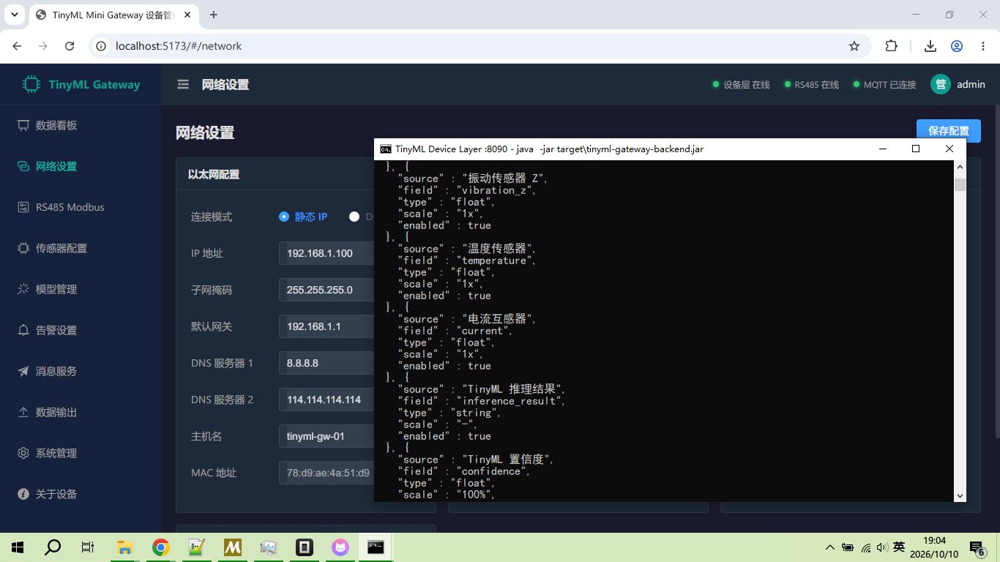

# TinyML Mini Gateway

面向工业设备状态监测的智能边缘网关演示系统，包含 **Web 管理前端** 与 **模拟设备层后端** 两部分。

## 界面预览

左侧为 Web 管理界面，右侧为模拟设备层终端：前端操作产生的数据会实时发送到设备层并在其终端打印出来。



## 项目结构

```
tinyML_mini_gateway/
├── tinyML_mini_gateway_web/       # 前端：Vue 3 + Vite + Element Plus + ECharts
│   ├── src/views/                 # 数据看板 / 网络 / Modbus / 传感器 / 模型 / 告警 / MQTT / 输出 / 系统
│   ├── src/utils/deviceApi.js     # 设备层通信封装
│   └── vite.config.js             # /api 代理到设备层
├── tinyML_mini_gateway_backend/   # 后端：Spring Boot 3.3.3（模拟设备层）
│   └── src/main/java/com/tinyml/gateway/
│       └── controller/DeviceLayerController.java
└── JAVA开发环境使用指南.md
```

## 组件说明

| 组件 | 技术栈 | 端口 | 说明 |
|------|--------|------|------|
| 前端 | Vue 3 / Vite / Element Plus | 5173 | 设备管理 Web 界面 |
| 后端（设备层） | Spring Boot 3.3.3 / WebFlux | 8090 | **只接收**前端数据并在终端打印，模拟真实设备层 |

## 快速开始

### 1. 启动设备层后端

```powershell
# 依赖走国内（阿里云）源，使用便携版 Maven
$MVN = "D:\development\111111111\tools\apache-maven-3.9.16\bin\mvn.cmd"
$SET = "D:\development\111111111\tools\settings.xml"
& $MVN -s $SET -f .\tinyML_mini_gateway_backend\pom.xml clean package -DskipTests

# 运行
.\tinyML_mini_gateway_backend\run.cmd
# 或： java -jar .\tinyML_mini_gateway_backend\target\tinyml-gateway-backend.jar
```

启动后终端会打印 `TinyML 网关模拟设备层已启动`。

### 2. 启动前端

```powershell
cd .\tinyML_mini_gateway_web
npm.cmd install
npm.cmd run dev
```

浏览器访问 <http://localhost:5173>（默认账号 `admin / admin`）。

### 3. 观察设备层仿真

在前端页面执行「保存配置 / 应用 / 开始训练 / 重启设备」等操作时，数据会经
`/api` 代理发送到设备层后端，并在其终端以如下形式打印：

```
================================================================================
[设备层] 2026-10-10 18:42:41.906  <== 收到前端数据 : output/config
--------------------------------------------------------------------------------
{
  "http" : { "enabled" : true, "url" : "https://api.example.com/tinyml/data" }
}
================================================================================
```

## 设备层接口

| 方法 | 路径 | 说明 |
|------|------|------|
| GET  | `/api/health` | 健康检查（前端顶栏状态指示灯） |
| POST | `/api/device/{category}` | 接收某类配置（network / sensor / modbus / mqtt / alarm / output …） |
| POST | `/api/device/{category}/{action}` | 接收动作指令（如 `modbus/scan`、`system/reboot`、`model/train`） |

> 设备层不做真实业务处理，仅将收到的 JSON 格式化后打印到终端，用于仿真。

## 备注

- 若使用 cmd 终端出现中文乱码，先执行 `chcp 65001` 再启动。
- 构建依赖使用阿里云镜像（见 `JAVA开发环境使用指南.md`）。
